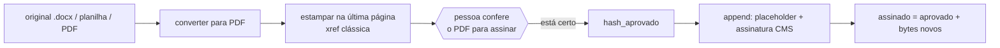

# ADR 0008 — Assinatura digital: a estampa vem antes, a assinatura é *append* sobre os bytes aprovados

**Status**: aceito (implementado) · **Data**: 03/10/2026

## Contexto

A assinatura digital de um PDF só vale se **nada mudar depois dela**: ela cobre
um intervalo de bytes (`/ByteRange`), e qualquer reescrita do arquivo invalida
essa cobertura.

Ao mesmo tempo, o documento que vai ser assinado não sai pronto. Há duas
transformações que *alteram* o PDF:

1. a **conversão** de `.docx` e planilha em PDF (LibreOffice), que pode
   distorcer layout, fonte ou quebra de página; e
2. a **estampa visível** (nome do titular, CPF mascarado, cidade, data e código
   de verificação), desenhada numa página do PDF.

E há uma exigência do usuário: a assinatura é feita com o e-CPF de uma pessoa
física, num documento que vai à concessionária. **Ninguém pode assinar uma
conversão — nem uma estampa — que não foi olhada por uma pessoa.** A conferência
humana precisa cobrir *tudo* o que será assinado, inclusive a estampa.

Se a estampa fosse desenhada junto da assinatura, a pessoa conferiria um PDF e o
robô assinaria outro.

Um detalhe técnico agravou o problema, descoberto numa bancada em 03/10/2026:
o `plainAddPlaceholder` (de `@signpdf/placeholder-plain`), que prepara o PDF para
receber a assinatura, **não lê PDF com *xref stream*** — que é justamente o
formato que o `pdf-lib` grava por padrão. Falha com `Expected xref at NaN`.

## Decisão

1. **A estampa é desenhada no passo de preparo**, junto da conversão, e o
   resultado é o **"PDF para assinar"** que aparece na tela. Só depois do "está
   certo" da pessoa ele entra na fila. A conferência humana cobre a conversão e
   a estampa.
2. O `pdf-lib` grava esse PDF com **`useObjectStreams: false`**, ou seja, com
   tabela *xref* clássica — o único formato que o `plainAddPlaceholder` lê.
3. **Assinar é *append* puro.** Na hora de assinar, o robô baixa o PDF aprovado,
   confere que o SHA-256 é o `hash_aprovado` gravado no "está certo" e só então
   acrescenta o placeholder e a assinatura CMS **ao final do arquivo**, sem
   reescrever nenhum byte do que foi conferido.
4. A propriedade é **verificada em runtime**, não só em teste: `assinar()`
   confere, antes de devolver, que (a) os bytes aprovados são **prefixo exato**
   do arquivo assinado, (b) há um `/ByteRange` real e (c) o `/Contents` não é só
   o placeholder zerado. Se qualquer uma falhar, **lança erro** e a assinatura é
   descartada — a garantia deixou de depender de o consumidor lembrar de chamar
   uma função de conferência.
5. Do "está certo" em diante, **nenhum byte é reescrito**. O original nunca é
   tocado e o assinado entra como documento novo.

## Consequências

**Ganhos**
- A conferência humana cobre exatamente o que será assinado. O "está certo"
  tem objeto: um arquivo com hash.
- A propriedade "aprovado é prefixo exato do assinado" é **verificável por
  qualquer um**, com `Buffer.equals`, e o próprio `assinar()` a exige.
- Uma troca do arquivo entre o "está certo" e a assinatura é pega pelo hash.
- O erro mais comum de integração (xref stream) deixou de existir: o formato é
  garantido na origem, no mesmo ponto onde a estampa é salva, com testes que
  discriminam (tabela em linha própria presente, `/Type /XRef` ausente, e o
  contraste com o original em xref stream).

**Custos e armadilhas**
- O preparo e a assinatura são **dois passos** no worker e há uma espera humana
  entre eles. Era o desejado, mas a assinatura não é instantânea.
- Qualquer mudança futura no preparo que volte a gravar com object streams
  quebra a assinatura com `Expected xref at NaN` — e o erro só aparece na hora de
  assinar, não na de preparar. O teste da xref clássica é o guarda.
- A estampa leva a data do **preparo**, não a do instante da assinatura.
- A estampa é um retângulo opaco na última página: em desenho de página cheia
  pode cobrir um carimbo do canto inferior direito. A pessoa vê no passo de
  conferência, mas não tem como mover.
- `plainAddPlaceholder` corta `\n`/`\r` finais e re-adiciona só `\n`: um PDF
  aprovado terminando em `%%EOF\r\n` perderia o `\r` e deixaria de ser prefixo.
  Com `pdf-lib` não acontece; a conferência interna é a rede de segurança.
- Isto **não** é PAdES-Baseline: o subfiltro é `adbe.pkcs7.detached`, sem
  carimbo de tempo e sem política AD-RB (ver [overview](../modules/signatures/overview.md)).

## Alternativas descartadas

- **Estampar e assinar num salto só.** Mais simples e mais rápido, mas a
  estampa (e a conversão) seriam produzidas e assinadas sem que ninguém as
  visse. Exigiria **confiar na conversão sem conferência humana** — exatamente o
  que o usuário não aceita para um documento assinado com o e-CPF do
  engenheiro. Descartada.
- **Reescrever o PDF depois de assinar** (por exemplo, para acrescentar a
  estampa por cima). Invalida o `/ByteRange` da assinatura. Inviável por
  construção; está aqui só para registrar por que a estampa *tem* de vir antes.

## Referências

Spec §4–§5 · [business-rules.md](../modules/signatures/business-rules.md)
(RN-ASS-07, RN-ASS-08, RN-ASS-23) · `worker/assinador/src/assinar.ts`
(`estampar`, `assinar`, `conferirAssinado`).
