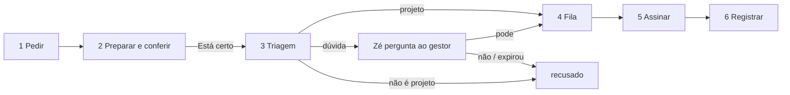

# Módulo: Assinatura digital

## Objetivo
Assinar documento de projeto **dentro do GD Manager**, com o certificado digital
do engenheiro responsável, sem o arquivo sair do sistema para o Gov.br ou para o
programa do certificado e voltar como anexo. Com mais gente na operação, o que
precisa ficar sob controle é: *o que* pode ser assinado, *quem* pediu, com
*qual* certificado, e *o gestor ficar sabendo* de cada uso.

> **Estado: 🟡 Fase 1 — só GD Manager** (tenant `is_library`, o mesmo recorte do
> Bidu, da Ludmilla e do Zé). Código, banco e telas prontos e revisados;
> **o aceite ponta a ponta ainda não foi feito** — o roteiro está em
> [aceite.md](aceite.md). A tela autenticada nunca foi vista por quem a
> construiu, e o worker nunca rodou na VPS.
>
> Spec: [`docs/superpowers/specs/2026-10-02-assinatura-digital-design.md`](../../superpowers/specs/2026-10-02-assinatura-digital-design.md) ·
> Plano: [`docs/superpowers/plans/2026-10-03-assinatura-digital.md`](../../superpowers/plans/2026-10-03-assinatura-digital.md) ·
> ADR: [0008 — a estampa vem antes, a assinatura é append](../../adr/0008-assinatura-append-sobre-bytes-aprovados.md)

## Pré-requisito que pode travar tudo: o certificado

O sistema só usa **certificado A1 de arquivo** (`.pfx` / `.p12`) emitido para a
**pessoa física** do engenheiro responsável (e-CPF), com o CPF dele.

- **Se hoje a assinatura é feita pelo Gov.br, isso não serve**: o Gov.br não
  exporta arquivo de certificado, e não existe API pública para assinar em nome
  de terceiro.
- **A3** (token ou cartão) também não serve: a chave nunca sai do dispositivo,
  e o robô roda numa VPS.
- **e-CNPJ** não serve: o cadastro exige CPF com 11 dígitos, porque a assinatura
  é do engenheiro, não da empresa.

## O que a assinatura é — e o que não é

O PDF assinado carrega uma assinatura CMS embutida, no formato
**`adbe.pkcs7.detached`**, feita com o certificado A1 do engenheiro.

Ela **não** leva carimbo de tempo de uma Autoridade de Carimbo do Tempo (ACT) e
**não** leva a política AD-RB da ICP-Brasil. Por isso **não é PAdES-Baseline** e
a documentação não a chama assim. Em termos práticos: a assinatura prova que
aquele certificado assinou aqueles bytes, mas o horário nela é o do relógio do
servidor, não o de um terceiro de confiança.

Se o ITI a aceita ou não é exatamente o que o passo "validar em
`validar.iti.gov.br`" do [aceite](aceite.md) responde. Se não aceitar, o caminho
é carimbo do tempo de uma ACT — hoje **fora de escopo**
([roadmap](../../project/roadmap.md)).

## Quem usa

- **Staff e admin** do tenant GD Manager pedem assinatura, conferem o PDF e
  acompanham o extrato.
- **Só o admin** cadastra o certificado, mexe no catálogo e libera exceção pela
  tela.
- **O gestor**, no WhatsApp, pelo Zé: recebe o aviso de toda assinatura e
  decide as exceções.
- **Empresas (`company`)** e demais tenants: não veem nada disso.

> **Decisão consciente do usuário (spec §9):** o staff assina com o e-CPF do
> engenheiro responsável — é o que a operação exige. O controle **não é
> impedir, é rastrear**: catálogo fechado, recado do Zé a cada assinatura,
> exceção só com o "pode" do gestor e extrato com quem pediu e quando. Quem usa
> a conta de staff responde pelo que assinou em nome do engenheiro.

## O fluxo em seis passos

1. **Pedir.** No modal do projeto, aba **Assinaturas**: a pessoa escolhe o tipo
   do catálogo, o arquivo e (opcional) o motivo. O arquivo sobe para
   `project-documents`, entra em `documents` com a marca do tipo e nasce o
   pedido em `preparando`.
2. **Preparar e conferir.** O assinador converte para PDF o que não é PDF
   (`.docx`, planilha) e desenha a **estampa visível** na última página (nome do
   titular, CPF mascarado, cidade do projeto, data, código de verificação). Esse
   PDF aparece na tela e **só segue depois do "Está certo, assine"**. Ninguém
   assina uma conversão — nem uma estampa — que não foi olhada. O arquivo
   original não é tocado.
3. **Triagem.** Se o tipo exige (`exige_triagem`), o Claudinho lê o PDF
   preparado e diz `projeto`, `nao_projeto` ou `duvida`. A triagem **falha
   fechada**: qualquer coisa que não seja um veredito legível vira dúvida.
4. **Fila.** `projeto` vai direto para a fila (`pendente`). `nao_projeto` é
   recusado com o motivo. `duvida` vira pedido ao gestor: o Zé pergunta
   "Libero?" no WhatsApp; só o "pode" dele coloca na fila.
5. **Assinar.** O assinador confere que o PDF aprovado não mudou, abre o `.pfx`
   com a senha (só em memória), confere validade e CPF, **anexa** a assinatura
   aos bytes aprovados e confere que eles continuam sendo o começo exato do
   arquivo assinado.
6. **Registrar.** O `..._assinado.pdf` entra no projeto como **documento novo**,
   com comentário no card, linha no histórico do projeto e o recado do Zé
   ("Assinei … com o e-CPF de …, 14:32. Código AX7F2.").

Em qualquer passo o pedido pode ser cancelado pela tela enquanto não terminou.
Detalhes e a tabela de transições em [database.md](database.md); as regras em
[business-rules.md](business-rules.md).

## A tranca: o que pode ser assinado

Esta é a parte que o usuário mais pediu — "disponibilizar essas assinaturas
apenas para os documentos cadastrados" — e é **determinística**, não depende de
IA nem de a tela se comportar.

> **Só é assinável o documento que entrou pela porta da assinatura, com um tipo
> escolhido do catálogo de documentos assináveis.**

Por que a regra é a *porta de entrada* e não o `document_type`: tudo o que o
Bidu gera entra como `extra_attachment`, igual a qualquer anexo solto. O tipo
sozinho não distingue "memorial do projeto" de "contrato comercial".

Como a regra se mantém, em camadas:

1. **Catálogo e marca.** Cada documento assinável carrega `assinavel_id`,
   apontando para um tipo **ativo** do catálogo do tenant. Contrato social,
   procuração avulsa, documento pessoal e qualquer anexo comum sobem pelas
   outras abas, ficam sem a marca, não ganham botão de assinar — e o banco
   recusa mesmo que alguém chame a função na mão.
2. **Só o banco coloca a marca.** A tela não tem permissão de gravar essa
   coluna (privilégio por coluna em `documents`) e ninguém tem `UPDATE` na
   tabela. As únicas portas são duas funções do banco, que conferem equipe,
   tenant, projeto vivo, tipo ativo e que o arquivo está na pasta do projeto.
3. **Triagem.** Cobre o caso de alguém subir um contrato escolhendo o tipo
   "Memorial descritivo": o Claudinho lê o conteúdo e barra. É a segunda camada,
   **nunca a única**.
4. **Exceção só com o "pode" do gestor.** Na dúvida, a assinatura espera o
   gestor responder no WhatsApp. Sem resposta em 24 h, **expirado = recusado**.
5. **Rastro.** Quem pediu, quem liberou, qual certificado, qual hash, quando.

## Onde ficam as telas

| Onde | O que tem | Quem |
|---|---|---|
| **`/assinaturas`** (item "Assinaturas" na sidebar) | Cartão do **certificado** (titular, CPF mascarado, emissor, série, validade com selo "vence em N dias", cadastrar/trocar) — **só o admin vê**; bloco **"Esperando você"** (PDFs para conferir, com "Está certo, assine", e pedidos de exceção, com "Liberar" — só admin — e "Não assinar"); **Histórico** do tenant (o que foi assinado, projeto, quem pediu, quem liberou, certificado, situação, "Abrir assinado" e "Ver o PDF" preparado) | admin + staff |
| **Modal do projeto → aba Assinaturas** | Estado do certificado, "Assinar documento" (tipo + arquivo + motivo), lista do que já foi pedido no projeto, com o código de verificação, o botão "Está certo, assine" e a recusa **à vista, com o motivo** | admin + staff |
| **Aba de anexos** | Nada muda. Documento sem a marca não ganha botão | todos |
| **WhatsApp** | Recados do Zé e o "Libero?" | gestor |

> **`/assinaturas` e não `/painel`.** O `/painel` é o console do **master** da
> plataforma; quem cadastra o certificado é o admin do tenant, que lá não entra.
> A rota segue o molde de `/ludmilla` (admin + staff, tenant `is_library`).

Código: `src/pages/Assinaturas.tsx`, `src/components/projects/TabAssinaturas.tsx`,
hook `src/hooks/useAssinaturas.ts`.

## Peças

| Peça | Onde | Papel |
|---|---|---|
| Banco | `supabase/migrations/20261003*` | tabelas, funções (RPCs), tranca, crons |
| **Assinador** | `worker/assinador/` (VPS, systemd `gdm-assinador`) | prepara, tria e assina; confere certificados; entrega os recados do Zé |
| `assinatura-triagem` | `supabase/functions/assinatura-triagem/` | a peneira do Claudinho (só o robô chama); publicada pelo passo "Deploy assinatura-triagem" do `deploy.yml` |
| `ze-brain` (`modo:'recado'`) | `supabase/functions/ze-brain/` | entrega o texto pronto ao gestor, sem chamar o modelo |
| Deploy do robô | `.github/workflows/assinador-worker.yml` + `worker/assinador/deploy/` | workflow manual: testa, compila, sincroniza, instala |

O assinador segue o molde do worker da Ludmilla (Node 22 + TypeScript, `.env`
em `/etc/gdm-assinador/env` com a service role, que **nunca sai da VPS**). A
diferença é que a service role vai ao servidor pelo **stdin** do `ssh`, e não na
linha de comando — ver [segurança](../../project/security.md#certificado-digital).

Bibliotecas: `pdf-lib` (estampa), `@signpdf/*` (placeholder + assinatura CMS),
`node-forge` (**só para ler o `.pfx`** — ver [RN-ASS-22](business-rules.md)) e LibreOffice headless
(`soffice`) para converter.

## O que foi construído diferente da spec

A spec é a autoridade do desenho; estes pontos divergem do que ela previa e a
documentação segue o código:

- **Documento gerado pelo Bidu/template não entra por clique.** A spec previa
  que `concessionaire_templates.assinavel_id` e um parâmetro novo em
  `bidu_anexar_documento` marcassem o gerado como assinável. **Isso não foi
  feito**: a coluna existe e está sem uso, e a tela só oferece o *envio de
  arquivo*. Hoje, para assinar o que o Bidu gerou, baixa-se e envia-se pela aba
  Assinaturas. A função `documento_marcar_assinavel` e o caminho `documentId`
  do hook existem para esse dia, mas nenhuma tela os chama.
- **O assinado nasce sem a marca** (`assinavel_id = NULL`): senão ele mesmo
  seria assinável (assinatura sobre assinatura, que é cosign, fora de escopo). O
  vínculo com o tipo fica em `assinaturas.assinavel_id` e
  `documento_assinado_id`.
- **O aviso do Zé passa por uma fila no banco (`ze_recados`)**, entregue pelo
  próprio assinador, e não por uma chamada direta única. Motivo: o `ze-brain` só
  roda quando o gestor escreve, então abrir a pendência não avisava ninguém.
- **A função que fecha o passo chama-se `assinatura_passo`** (a spec dizia
  `assinatura_finalizar`) e ganhou uma tabela de transições válidas.
- **`certificado_cadastrar` recebe 4 parâmetros** (caminho, senha, nome, CPF);
  a spec dizia 3.
- **O catálogo não tem tela.** Mexer nele é pela função
  `catalogo_assinavel_salvar` (só admin), por SQL ou RPC.

## Limites conhecidos

Fora de escopo: Gov.br, certificado A3, mais de uma assinatura no mesmo PDF
(cosign), carimbo do tempo de ACT e validação de assinatura de terceiros.
Dívidas registradas em [roadmap.md](../../project/roadmap.md#assinatura-digital).
