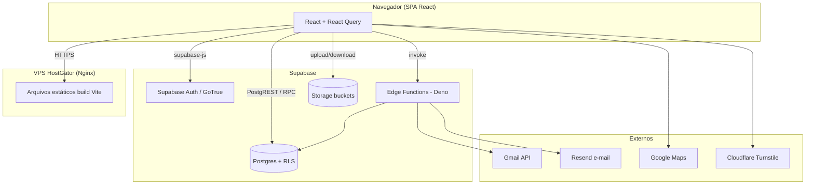
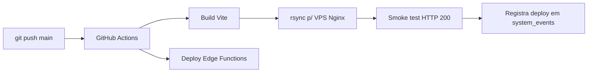

# Arquitetura

## Visão geral

GD Manager Energy é um **SaaS multi-tenant** para homologação de projetos
fotovoltaicos. A arquitetura é **serverless-first**: não existe um servidor de
aplicação próprio. O front-end é uma SPA estática e todo o back-end é o
**Supabase** (Postgres gerenciado + Auth + Storage + Edge Functions).

## Camadas e responsabilidades

1. **Apresentação (SPA)** — `src/pages` e `src/components`. Renderização,
   navegação (React Router) e estado de servidor via React Query. Sem regra de
   negócio sensível — o cliente é considerado não confiável.
2. **Acesso a dados (hooks)** — `src/hooks/use*.ts`. Cada hook encapsula queries
   e mutations do Supabase para uma entidade. É a fronteira entre UI e dados.
3. **Lógica de servidor**:
   - **RPCs SQL** (`SECURITY DEFINER`) para agregações e operações que exigem
     privilégio controlado (ex.: console master, cálculo de valor, tokens
     públicos).
   - **Edge Functions (Deno)** para o que precisa de segredo ou serviço externo
     (criação de usuários com `service_role`, envio de e-mail, scan de Gmail,
     autocadastro de tenant).
4. **Persistência** — Postgres com **RLS** como mecanismo central de
   autorização. Storage para arquivos (documentos, templates, logos).

## Multi-tenancy

- Cada empresa assinante é um registro em `tenants`. Todo dado de negócio
  carrega `tenant_id`.
- **Políticas RLS RESTRICTIVE** (`tenant_isolation`) garantem que cada usuário
  só enxergue linhas do seu tenant. RESTRICTIVE porque combina com as políticas
  PERMISSIVE por papel via `AND` — nenhuma política de papel pode "furar" o
  isolamento.
- Helpers no banco: `get_user_tenant_id(uuid)`, `is_master(uuid)`,
  `tenant_has_access()`, `has_role(uuid, role)`.
- O **master** (GD Manager) administra a plataforma pelo console `/painel`, via
  RPCs `SECURITY DEFINER` gated por `is_master`. O master **não** enxerga dados
  de tenants no painel comum — as políticas de isolamento não têm bypass de
  master (decisão de segurança). Ver [security.md](security.md).
  Seções do console: Visão geral, Tenants, Acessos, Uso da plataforma,
  Financeiro, **Agentes de IA** (extrato de uso: saldo estimado em USD =
  recargas lançadas − custo por tokens reais de cada chamada; quebra por
  agente/tenant/dia; alerta de reabastecimento; RPCs `console_ai_usage`,
  `console_ai_add_credit`, `console_ai_delete_credit`; tabela
  `ai_credit_entries` sem policies — acesso só via essas RPCs) e
  Monitoramento.

## Comunicação entre módulos

Os módulos não se chamam diretamente no front-end; compartilham o **banco** como
integração. Ex.: o módulo de Projetos grava `project_general_data`; o módulo
Financeiro reage via trigger `fn_set_project_value`; Notificações disparam via
`dispatchNotification` no evento de criação. Regras de negócio que precisam ser
inquebráveis vivem em **triggers/RPCs no banco**, não no cliente.

## Padrões adotados

- **Fonte única de verdade** para variáveis de template do projeto:
  `src/utils/projectValues.ts` (`buildProjectValues`) — usada tanto por "Gerar
  documento" quanto pelo Pacote do Projetista.
- **Feature-by-hook**: uma entidade = um hook em `src/hooks`.
- **RLS como autorização**, não checagem no cliente. O cliente pode esconder
  botões, mas a barreira real é o banco.
- **Auditoria por trigger** (`fn_audit_row`) grava em `system_events` toda
  criação/alteração/exclusão nas tabelas sensíveis — independe da origem.
- **Deploy imutável**: cada push na `main` gera build e publica; a publicação é
  registrada em `system_events` (kind `deploy`).

## Fluxo de deploy

### `/assets` não é apagado no deploy

O rsync roda em **duas passadas**: `dist/assets/` sobe **sem** `--delete` (as
versões antigas ficam no ar) e o resto do site espelha o build com `--delete`,
excluindo `assets/`. Um `find -mtime +30 -delete` limpa o que já está velho.

O motivo é concreto: os arquivos de `/assets` têm hash no nome e partes do app
carregam **sob demanda** (o gerador de PDF, o leitor de PDF, o html2pdf).
Apagando os assets antigos, quem estava com a aba aberta quando saiu uma versão
nova continua pedindo o pedaço antigo e recebe **404** — a funcionalidade morre
sem erro visível. Foi o que derrubou o "Baixar PDF" do diagrama em jul/2026.
Ver [modules/diagrams](../modules/diagrams/overview.md).

## Armazenamento da VPS no painel

A mesma VPS que serve o estático pelo Nginx hospeda o worker da Ludmilla e a
importação da BDGD (gigabytes baixados e descompactados). Ficar sem disco no
meio é falha silenciosa, então o espaço livre é medido e mostrado.

A SPA é estática e não vê o disco. Quem vê é o **worker da Ludmilla**, que já
roda lá: `reportarDisco()` (`worker/ludmilla/src/fila.ts`) mede com `statfs`
— a aritmética fica em `medidaDe()` (`src/disco.ts`), separada e testada — e
grava por RPC. O batimento é de **15 minutos**, mais uma medição ao subir, e
vive fora do `if` de modo em `index.ts`, porque o batimento que já existia
(`pulsar`, da estação local) só roda no modo `local` e o ramo da VPS não tinha
nenhum.

- **`vps_armazenamento`** — host, partição, total/usado/livre em bytes,
  `origem` (`worker` no batimento, `ingestao` durante uma importação), `etapa`,
  `medido_em`. RLS: leitura só master por `public.is_master(auth.uid())`;
  **nenhuma política de escrita para `authenticated`** — só o service role
  grava, pela RPC. Retenção de 90 dias por `pg_cron` (job
  `vps_armazenamento_retencao`, às 4h17 para não disputar o `:00`).
- **`vps_armazenamento_registrar(...)`** — escrita; recusa quem não é service
  role e tem `EXECUTE` revogado de `anon` e `authenticated`.
- **`console_vps_armazenamento(p_dias)`** — leitura: última medição + série
  diária, no padrão das outras `console_*`.
- **`VpsStorageCard`** (`src/pages/painel/VpsStorageCard.tsx`) — card no topo da
  aba **Monitoramento** do `/painel`: GB livres, barra de ocupação com as marcas
  de **80%** (atenção) e **90%** (crítico), e a série de 30 dias. Os limiares
  são constantes nomeadas no componente, não configuração em tabela — dívida
  registrada: na terceira configuração de plataforma, vale criar a tabela.

Spec: [capacidade de rede, §5](../superpowers/specs/2026-10-10-capacidade-rede-design.md).

## A ingestão da BDGD na VPS

Terceiro processo na VPS, ao lado do Nginx e do worker da Ludmilla — e
**separado** dela de propósito: é trabalho de minutos, e não pode travar o robô
dos portais. Entrada própria: `npm run bdgd -- <sigla>`
(`worker/ludmilla/src/bdgd/`), reaproveitando de lá o cliente Supabase e o
`reportarDisco`, para não duplicar o segredo de service role.

Dependência de **sistema**, não de npm: `gdal-bin` (o `ogr2ogr`). É ele que lê
o Geodatabase da ANEEL e faz a agregação **fora do banco** — 2 milhões de
unidades consumidoras viram ~54 mil linhas antes de qualquer coisa subir. Por
isso a carga vai por PostgREST em lotes, sem `COPY` e sem conexão Postgres
direta: não há volume que justifique nenhum dos dois.

A atomicidade é de uma função: os lotes caem em `rede_stg_*` (que ninguém lê,
RLS ligada e nenhuma política) e `rede_importacao_promover()` promove tudo numa
transação, para o mapa nunca ficar meio-carregado. A faxina do staging é feita
depois, pelo worker — não é invariante, e se falhar o `ON DELETE CASCADE`
resolve.

Disco: o guard-rail recusa **antes** de baixar, somando zip e extraído com a
inflação medida de 5,3× (CPFL Paulista exige 10 GB livres; Piratininga, 3,4 GB).
E cada etapa chama `reportarDisco('ingestao', etapa)`, que é a `origem` que já
existia na tabela do painel.

Detalhe do módulo: [engineering/overview.md](../modules/engineering/overview.md#a-ingestão-da-bdgd).

Ver também: [tech-stack.md](tech-stack.md) · [security.md](security.md) ·
[integrations.md](integrations.md).
